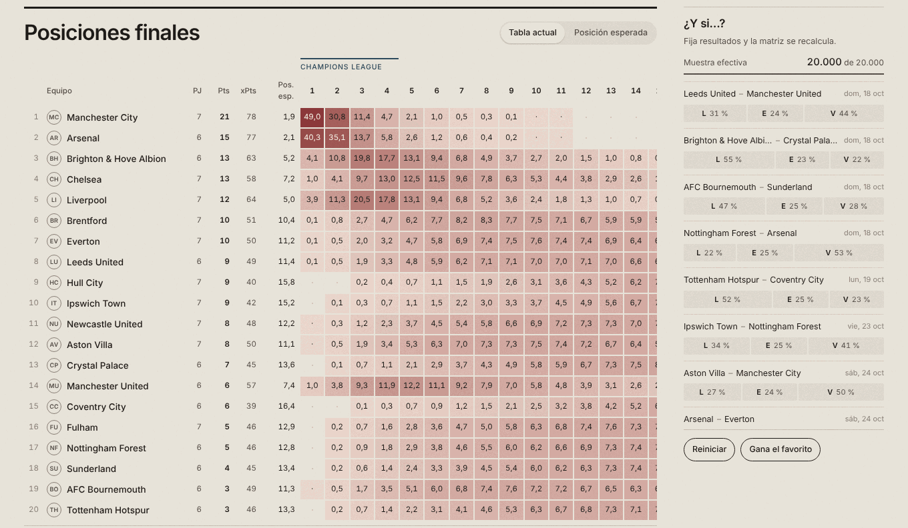

# càdlàg

**Dónde termina cada equipo.** Probabilidades de la posición final en nueve ligas de fútbol y
de hasta dónde llega cada equipo en la Champions League, calculadas con un modelo bayesiano
dinámico de goles y tiros al arco y 20.000 temporadas simuladas con las reglas reales de cada
competición.

**→ [cadlag.vercel.app](https://cadlag.vercel.app)**



Premier League, LaLiga, Serie A, Bundesliga, Ligue 1, Championship, Liga de Primera (Chile),
Brasileirão, Liga Profesional argentina y Champions League, actualizadas cada dos horas.

## Qué tiene de interesante

- **Un modelo que separa crear ocasiones de convertirlas.** Cada equipo tiene cuatro fuerzas
  (crear y evitar tiros al arco, convertirlos y que no se los conviertan) que evolucionan como un
  paseo aleatorio y se actualizan partido a partido con un filtro de Laplace. Fuera de muestra
  mejora al modelo de goles clásico en el conjunto de las nueve ligas (+0,004 nats por partido,
  z = 5,9) y queda a 0,004 de RPS de Bet365 en la Premier.
- **Incertidumbre honesta.** Cada temporada simulada sortea primero las fuerzas y después los
  partidos; fijar las fuerzas en su media subestima la varianza de los puntos a la mitad.
- **Reglas reales.** Desempates recursivos, partidos de definición, playoffs de ascenso de la
  Championship, zonas, llaves y promedios del fútbol argentino, descuentos de puntos.
- **"¿Y si…?" en el navegador.** Fijar resultados repondera las 20.000 temporadas sin volver
  a simular.
- **Una escala común para Europa.** En la Champions, cada equipo parte de su fuerza doméstica
  (16 ligas europeas modeladas) más el nivel de su liga en Europa; los pocos sin liga modelada se
  estiman solo con sus partidos europeos. Anclar a la liga mejora la predicción de los partidos UEFA fuera de
  muestra.
- **Ligas comparadas como una red eléctrica.** Los partidos de copa y los ascensos forman un grafo;
  su laplaciano da la fuerza relativa de cada liga y cuánta información las conecta.

La formulación, las demostraciones y todos los resultados (R1–R20, incluidos los negativos) están
en [`docs/teoria.md`](docs/teoria.md).

## Uso

```bash
python -m venv .venv && source .venv/bin/activate
pip install -e ".[dev,bayes,plots]"

cadlag run --no-update       # simula las ligas y exporta los datos del sitio
cd site && npm install && npm run dev   # sitio en http://localhost:3000
```

```
src/cadlag/   modelo, simulación, evaluación y exportación     site/      sitio (Next.js, estático)
scripts/      análisis y backtests del artículo                docs/      teoría, código y operación
data/         datos descargados y almacén de partidos          models/    hiperparámetros por liga
```

Más detalle: [`docs/codigo.md`](docs/codigo.md) (módulos, comandos y scripts) y
[`docs/operacion.md`](docs/operacion.md) (actualización automática y mantenimiento).

## Datos

Resultados y estadísticas de partidos de ESPN (API no oficial); cuotas de Bet365 y Elo de
football-data.co.uk y ClubElo, vía [xgabora/Club-Football-Match-Data](https://github.com/xgabora/Club-Football-Match-Data-2000-2025),
para evaluar contra el mercado.

## Licencia

El código es MIT (ver [`LICENSE`](LICENSE)). Los textos de `docs/` son CC BY 4.0: se pueden
compartir y adaptar citando la fuente. Los datos de terceros en `data/raw/` no quedan cubiertos por
estas licencias y siguen los términos de su origen.
